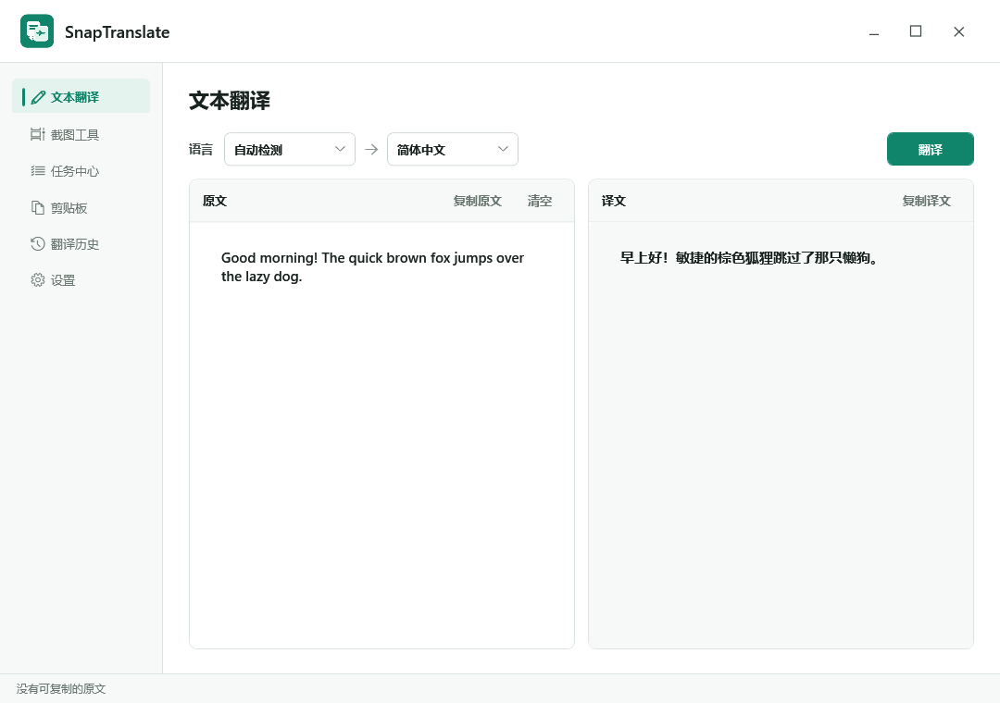
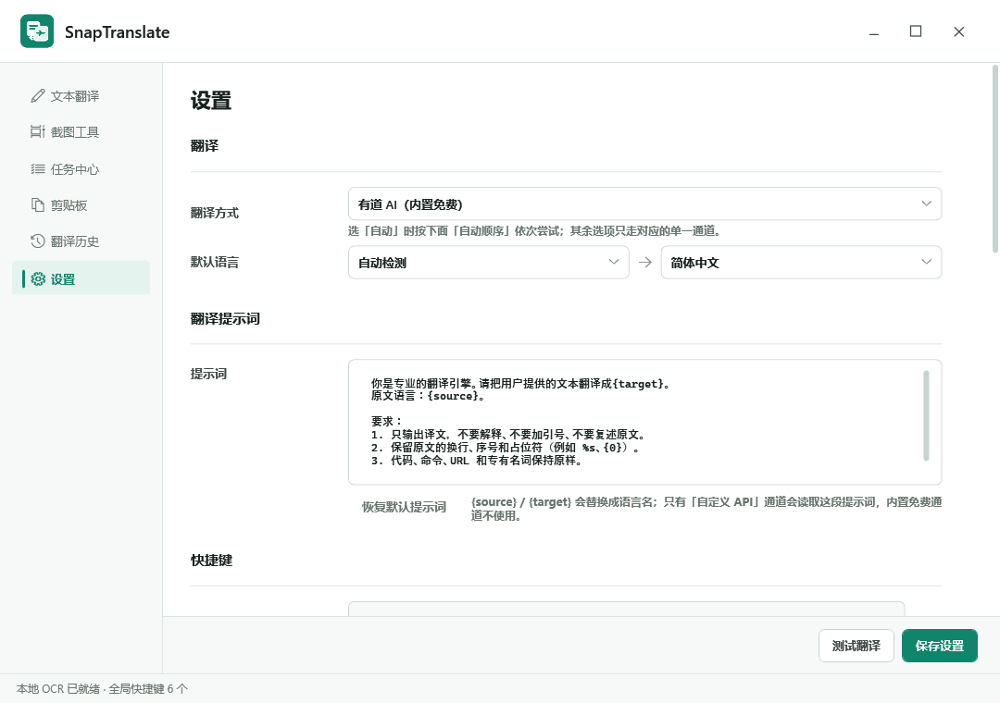
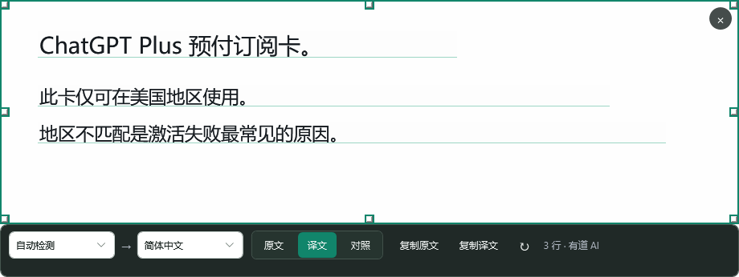
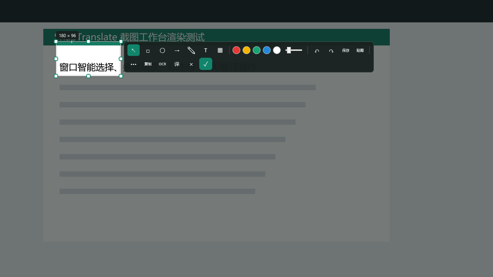
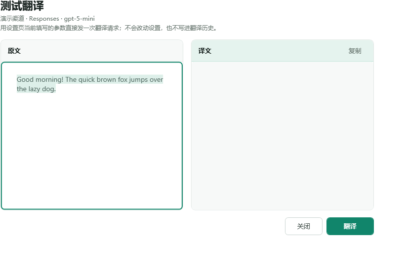

# SnapTranslate

[](https://dotnet.microsoft.com/)
[](#平台支持)
[](LICENSE)

面向 Windows 和 macOS 的桌面翻译工具：截图取词、划词翻译、OCR、剪贴板历史，一个程序全都做了。

*SnapTranslate is a desktop translation tool for Windows (WPF) and macOS (Avalonia): screenshot OCR translation,
text translation with multiple providers, clipboard history, and a global-hotkey workflow.*



| 设置 | 截图翻译 |
| --- | --- |
|  |  |

| 紧凑截图工具条 | 通道测试 |
| --- | --- |
|  |  |

## 特性

| 能力 | 说明 |
| --- | --- |
| 文本翻译 | 左侧原文右侧译文，支持复制原文/译文、快捷键发起、翻译历史 |
| 截图翻译 | 框选截图 → OCR → 覆盖在原文位置显示译文，支持对照/仅译文模式 |
| 截图标注 | 矩形、椭圆、箭头、画笔、文字、马赛克，撤销/重做，保存/贴图/复制 |
| OCR | 系统 OCR 引擎 + 多档预处理，对中英混排、深色背景、小字号做了针对性处理 |
| 剪贴板历史 | 文本/图片/文件全记录，搜索、收藏、备注，双击直接粘贴回原窗口 |
| 多通道翻译 | 有道 AI、有道普通翻译、自定义大模型 API（多渠道）、Transmart、MyMemory、Google，以及可自定义顺序的「自动」 |
| 文档翻译 | TXT/Markdown/CSV/HTML/Office/PDF，保留结构与格式，支持并发与进度 |
| 全局快捷键 | 低层键盘钩子，输入翻译、截图、截图翻译、静默 OCR、剪贴板、贴图各自可配 |
| 托盘常驻 | 关闭到托盘、开机自启、主窗口可选始终置顶 |

## 翻译通道

内置免费通道不需要任何配置，选了就能翻译：

- **有道 AI**：有道网页版的 LLM 翻译
- **有道 普通翻译**：有道传统翻译引擎，和 AI 通道是两套算法，可以互为参考
- **腾讯 Transmart / MyMemory / Google**：免费网页接口

需要配置的只有「自定义 API」：

- 支持多条渠道，每条独立保存名称、接口地址、API Key、模型
- 三种接口格式：Chat Completions、Responses、Messages
- 本地模型（Ollama / LM Studio / vLLM）也走这里，地址填到 `/v1`

「自动」模式按「自动顺序」里配置的列表依次尝试，顺序和包含的通道都能自己改。

## 平台支持

| 能力 | Windows (WPF) | macOS (Avalonia) |
| --- | --- | --- |
| 输入翻译与历史 | ✅ | ✅ |
| TXT/Markdown/CSV/HTML/Office/PDF 文档翻译 | ✅ | ✅ |
| 截图 OCR 与翻译 | ✅ Windows OCR | ✅ 系统 Vision |
| 截图标注、贴图 | ✅ | 暂未迁移 |
| 剪贴板历史 | ✅ | 暂未迁移 |
| 全局快捷键与托盘 | ✅ | 暂未迁移 |

## 下载

到 [Releases](https://github.com/auuuu4/SnapTranslate/releases) 页下载对应平台的包，全部由 GitHub Actions 从本仓库源码构建：

| 平台 | 文件 |
| --- | --- |
| Windows 10/11 x64 | `SnapTranslate-win-x64.zip`（解压即用，不需要 .NET 运行时） |
| macOS Apple 芯片 | `SnapTranslate-macos-arm64.zip` |
| macOS Intel | `SnapTranslate-macos-x64.zip` |
| 校验 | `SHA256SUMS.txt` |

> Windows 端未做代码签名，首次运行可能提示「已保护你的电脑」，选择「更多信息 → 仍要运行」。
> macOS 端未做 Apple 开发者签名，首次打开请右键选「打开」，或先执行 `xattr -dr com.apple.quarantine /Applications/SnapTranslate.app`。
> macOS 客户端目前只迁移了文本翻译、历史与文档翻译，截图/剪贴板等功能仍在 Windows 客户端上。

## 从源码构建

```powershell
# Windows 单文件 exe（自包含，约 190 MB）
.\scripts\publish-windows.ps1 -Runtime win-x64

# macOS 应用包（需在 macOS 上执行）
bash scripts/build-macos-helper.sh
dotnet publish src/SnapTranslate.Desktop/SnapTranslate.Desktop.csproj -c Release -r osx-arm64 --self-contained true
bash scripts/package-macos.sh osx-arm64 artifacts/publish/osx-arm64
```

推 `v*` tag 时，[Release 工作流](.github/workflows/release.yml) 会自动在两个平台各构建一次并把产物上传到 Release。

## 从源码构建与测试

需要 [.NET SDK 8.0.424](https://dotnet.microsoft.com/download)（`global.json` 已锁定版本）。

```powershell
dotnet build SnapTranslate.csproj -c Release
dotnet test tests\SnapTranslate.Core.Tests\SnapTranslate.Core.Tests.csproj -c Release
dotnet test tests\SnapTranslate.Desktop.Tests\SnapTranslate.Desktop.Tests.csproj -c Release
dotnet run --project tests\SnapTranslate.SmokeTest\SnapTranslate.SmokeTest.csproj -c Release -- --offline
```

冒烟测试还带几个开发用模式：

| 模式 | 用途 |
| --- | --- |
| `--ocr-eval` | 跑固定 OCR 样张，输出字符错误率（CER） |
| `--clipboard-image-formats` | 校验复制图片时写进剪贴板的格式（DIB + PNG） |
| `--render-input` / `--render-settings` | 把对应页面渲染成 PNG，用于人工检查布局 |
| `--render-capture-compact` / `--render-translation` | 渲染截图工具条与截图翻译窗口 |

更多约定见 [docs/DEVELOPMENT.md](docs/DEVELOPMENT.md)。

## 项目结构

```
SnapTranslate/
├─ SnapTranslate.csproj        Windows WPF 客户端（net8.0-windows10.0.19041.0）
├─ src/SnapTranslate.Core/     跨平台核心：设置、翻译通道、提示词、文档翻译
├─ src/SnapTranslate.Desktop/  macOS Avalonia 客户端
├─ tests/                      核心单测、Avalonia 无头渲染测试、WPF 冒烟测试
├─ scripts/                    发布 / 部署 / macOS 打包脚本
├─ tools/macos/                Swift Vision OCR 辅助程序
└─ docs/                       开发文档、架构说明、代码审计、截图
```

内部结构见 [docs/ARCHITECTURE.md](docs/ARCHITECTURE.md)，历史审计与已知风险见 [docs/AUDIT.md](docs/AUDIT.md)。

## 配置与数据

所有配置、历史、剪贴板数据都写在当前用户目录，不写安装目录：

- Windows：`%APPDATA%\SnapTranslate`
- macOS：`~/Library/Application Support/SnapTranslate`

其中 `settings.json` 里的 API Key 是**明文保存**的，分享截图或日志时请留意。

## 已知限制

- 有道 / Transmart / MyMemory / Google 走的是网页版接口，属于非官方接入，上游随时可能调整
- OCR 使用系统引擎，单字混淆（例如「设置」认成「设旨」）受模型能力限制，预处理只能缓解
- 程序未签名，部分杀毒软件可能误报

## 贡献

欢迎 issue 和 PR，提交前请读 [CONTRIBUTING.md](CONTRIBUTING.md)。安全问题请按 [SECURITY.md](SECURITY.md) 私下反馈，不要开公开 issue。

## 许可证

[MIT](LICENSE)，可自由用于商业项目，请保留版权声明。

## 免责声明

本项目与有道、腾讯、Google 等第三方服务无隶属关系，各接口的使用需遵守对应服务条款。翻译结果由第三方服务提供，请自行评估准确性。
